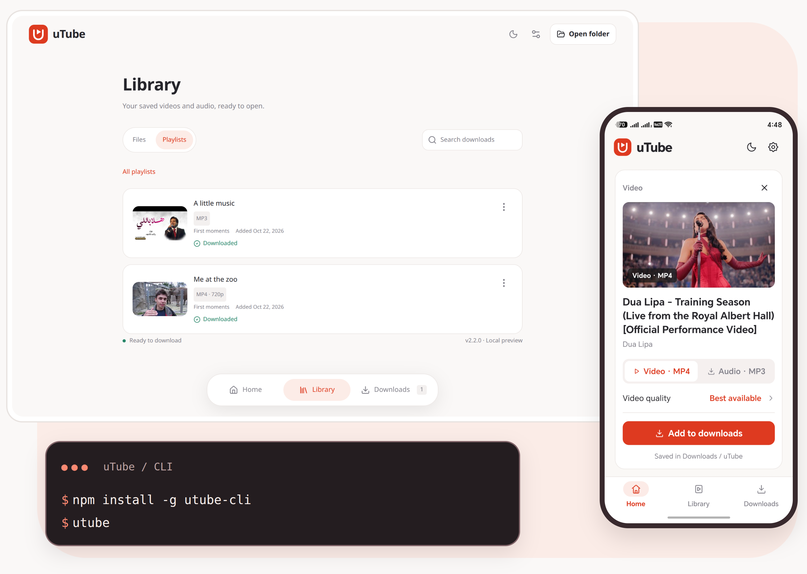
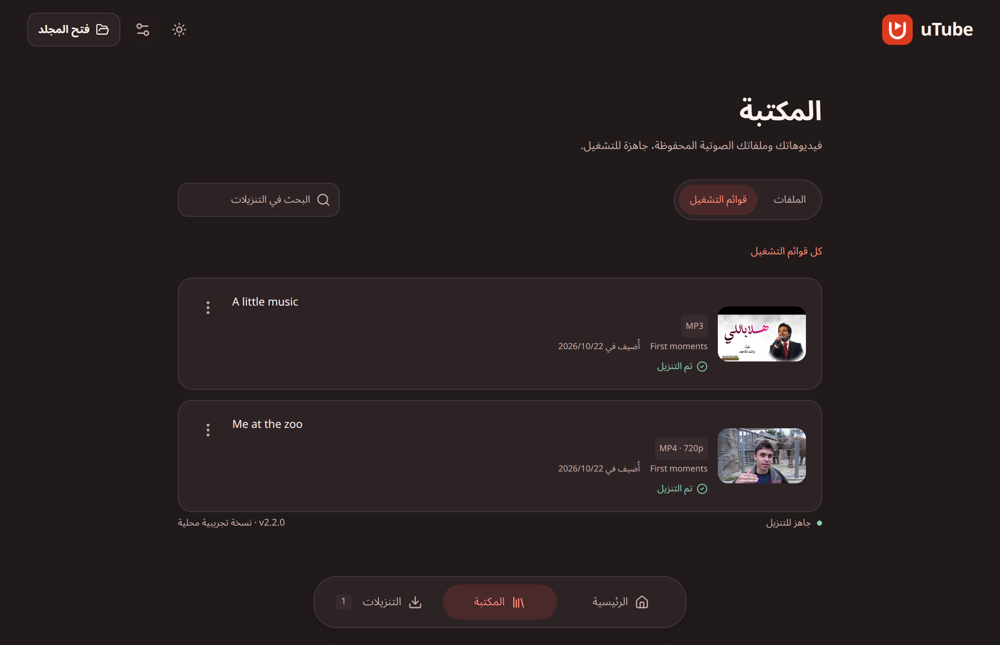

<div align="center">


# uTube

### Your YouTube library, offline. In one command or one click.

Download videos and whole playlists as **MP4** or **MP3** from a slick desktop app,
a friendly terminal, or the Android app.

<br>

[](https://www.npmjs.com/package/utube-cli)
[](#-desktop-app)
[](#-android-app)
[](LICENSE)

[🌐 Website](https://omer73364.github.io/uTube/) · [⚡ Quick start](#-quick-start) · [💻 CLI](#-cli) · [🖥️ Desktop](#-desktop-app) · [📱 Android](#-android-app) · [🛟 Help](#-troubleshooting)

<br>



<sub>🖥️ Desktop · 📱 Android · 💻 CLI</sub>

</div>

<br>

## 🎬 Choose your way to download

**🖥️ Desktop** gives you a visual library, playlist groups, and a download manager
for Linux, Windows, and macOS. Start with the [desktop downloads](#-desktop-app).

**📱 Android** brings the same red theme and library to your phone, with background
downloads and Android sharing. Install it from [GitHub Releases](https://github.com/omer73364/uTube/releases/tag/v2.4.0).

**💻 CLI** takes you from a link to a saved file through an interactive menu or a
single command. Install it with [npm](#-cli).

> [!NOTE]
> CLI, desktop, and signed Android downloads are at **2.4.0**, under one release tag.
> Windows and macOS downloads are unsigned previews and may show security
> warnings. macOS previews are not notarized.

<br>

## ✨ Why uTube?

- 🎞️ **Video or audio.** Download MP4 with sound, or convert audio to 192 kbps MP3.
- 🎯 **Quality first.** Try the requested resolution across available streams;
  if it cannot be saved, fall back to the best working lower resolution.
- 📚 **Whole playlists.** Select everything or just the videos you want,
  with each playlist saved in its own folder.
- 🔄 **Quiet recovery.** Stream retries stay out of the way, and displayed transfer
  progress does not jump backwards during automatic retries.
- 🧳 **History that sticks.** Desktop and Android retain download history
  and preferences after closing, with search, retry, and file-opening actions.
- 🌍 **English & العربية.** Desktop and Android offer English and العربية, right-to-left
  layouts, and light, dark, or system appearance.

<br>

## ⚡ Quick start

For the CLI, install [Node.js](https://nodejs.org/) **20+**. uTube offers to
download FFmpeg when needed for MP3 audio and HD video:

```sh
npm install -g utube-cli@latest
utube
```

Paste a link and follow the prompts. ✅

> [!TIP]
> Prefer clicking over typing? Try the [desktop app](#-desktop-app).
> Developing on your phone? Start with the [Android app](#-android-app).

<br>

## 🖥️ Desktop app

Home, Library, and Downloads are connected by a floating navigation bar inside
the app. The desktop now shares mobile's red accents, rounded cards, and warm
charcoal dark theme.

### 📦 Download

Find installers and archives on **[GitHub Releases](https://github.com/omer73364/uTube/releases)**:

- 🐧 **Linux x64:** Debian `.deb`, `.AppImage`, and `.zip`.
- 🪟 **Windows x64:** `Setup.exe` and portable `.zip`.
- 🍎 **macOS:** `.dmg` and `.zip` for Apple Silicon and Intel.

Desktop packages include their runtime, so Node.js is not required. The Debian
package installs FFmpeg as a dependency. Desktop 2.4.0 also offers
**Download FFmpeg** in Settings, with progress and cancellation. It saves the
verified tool for uTube only, without administrator access. Read the
[installation guide](docs/distribution.md) for platform instructions and checksums.

Existing previews are unsigned, and macOS previews are not notarized.

### 🪄 How it works

1. 🔗 Open **Home**, paste a YouTube video or playlist link, and choose **Preview link**.
2. 🎚️ Review the preview, choose MP4 or MP3, pick a quality, and select playlist items.
3. 📁 Confirm or change the destination, then add your downloads.
4. 📋 Follow progress in **Downloads**, or open completed files from **Library**.

**Home** shows recent downloads. **Library** contains saved video and audio,
with Files and Playlists views, playlist groups, and search. **Downloads** shows
all history with filters for active, completed, and attention-needed items.

Each thumbnail card has a three-dot options menu. Completed items offer
**Open file** and **Show in folder**; active items can be cancelled, and failed
or interrupted items can be retried. Format and quality appear below the title.
Unavailable thumbnails use a simple fallback.

In **Settings**, use visual theme choices, switch language, or choose a download
folder. The header includes a quick light/dark toggle and a folder shortcut.
Press **Ctrl+L** or **⌘+L** to return to the link input from any screen.

<details>
<summary><b>🌙 See it in Arabic · dark mode</b></summary>

<br>



<sub>Development preview with sample downloads.</sub>

</details>

### 🧳 History that sticks

Titles, playlist names, dates, quality, status, and file locations are saved
locally. Unfinished downloads return as **Interrupted** after closing; Retry
starts them again from the beginning. They do not restart automatically.

The desktop stores `downloads.json` in its user-data directory. The queue allows
up to 500 unfinished items; completed history does not consume that limit.
See the [desktop guide](apps/desktop/README.md) for recovery behavior and development.

<br>

## 📱 Android app

**Download, install, and go.** Get the signed [Android APK](https://github.com/omer73364/uTube/releases/tag/v2.4.0) for Android 10 or newer. The main APK supports both ARM64 and x86-64; smaller
CPU-specific APKs are available on the same release page. No computer or Metro server is needed. iOS is not implemented.

Allow your browser or file manager to install the APK when Android asks. If you used an older prototype signed with the development key, uninstall it first after saving anything you need from its history. Downloaded files remain in Downloads / uTube.

- 🏠 **Home, Library, and Downloads** with thumbnail cards, rounded navigation,
  search, status filters, and saved playlist groups.
- 🎞️ **HD MP4 and MP3**, with Best available or a chosen resolution, quiet candidate
  retries, and the actual saved quality shown in history.
- 📚 **Playlist selection**, continuation-page loading, and separate playlist folders.
- ⏬ **Background transfers and media processing** through a native foreground service.
- 🧳 **Persistent queue and preferences**, including failures and interrupted work.
- 🔗 **Download from YouTube’s share menu:** choose quality and select playlist videos in a compact sheet, with background downloads.
- 📂 **Open and share saved files**, cancel active work, and retry failed downloads.
- 🗑️ **Remove from list** for individual finished entries, or clear finished history,
  while keeping the downloaded files on your device.
- 🌍 **English and Arabic**, mirrored layouts, light/dark/system appearance, and a
  quick theme toggle. Dark mode uses warm charcoal and coral accents.
- 🎨 The shared red **uTube logo** in the app header and Android launcher icon.

Files are saved in **Downloads / uTube** through Android's media storage.
The queue allows up to 1,000 unfinished downloads; a playlist batch can contain
up to 1,000 videos.
Android can stop background work after a force-stop, restart, or system limit;
interrupted downloads remain available to retry. Partial transfers do not resume.

### 🛠️ Run on your phone

Install development dependencies first, as described under [Development](#-development).
Android also requires JDK 17, Android platform/build tools 37, NDK 27.1.12297006,
and configured `JAVA_HOME` and `ANDROID_HOME`. Use Android 10 or newer.

From the repository root, start Metro:

```sh
npm run mobile:start
```

In another terminal, connect a phone with USB debugging enabled:

```sh
adb reverse tcp:8081 tcp:8081
npm run mobile:android
```

Keep Metro running for the debug app. Repeat `adb reverse` after reconnecting
the phone. The root's `npm start` runs the CLI, not Metro.

For standalone APK/AAB builds, signing, dependency notices, and device tests,
see the [mobile guide](apps/mobile/README.md).

<br>

## 💻 CLI

Requires **Node.js 20+**. If FFmpeg is missing, the interactive menu offers to
download it for MP3 audio and HD video. You can also run `utube --install-ffmpeg`.
An existing system FFmpeg is used automatically.

```sh
npm install -g utube-cli@latest
utube
```

The guided menu lets you download a video or playlist, save audio, change the
folder, or exit:

```text
◆ What would you like to do?
❯ ↓  Download a video or playlist
  ♫  Download audio (MP3)
  ▣  Change download folder
  ↗  Exit
```

Use **↑ / ↓** to navigate, **Enter** to confirm, and **Space** to select playlist
items. The CLI uses red accents for menus, headings, borders, and progress,
with distinct success, warning, and error colors.

### 🎨 Clear details, steady progress

Each video gets a text card with its channel, duration, view count, format,
destination, and watch link when available. One live progress block follows
video, audio, and merging/conversion stages, showing transferred bytes, recent
speed, and ETA when the total is known. Unknown sizes show activity and bytes
without inventing a percentage. Narrow terminals use a compact layout.

Automatic stream retries preserve the displayed progress. Playlist downloads
continue after an individual failure and finish with saved, skipped, and failed
counts. The CLI is text-only; thumbnail rendering has been removed.

Set `NO_COLOR=1` to disable colors. Piped output uses plain status lines instead
of animated progress.

### 🚀 Or go direct

```sh
# 🎥 Video: pick the quality interactively
utube -u "https://youtu.be/jNQXAC9IVRw"

# 🎯 Video: request a resolution, with automatic fallback
utube -u "https://youtu.be/jNQXAC9IVRw" -q 720p

# 🎵 Audio: save as MP3
utube --audio -u "https://youtu.be/jNQXAC9IVRw"

# 📚 Playlist: choose all or specific items
utube -u "https://www.youtube.com/playlist?list=YOUR_PLAYLIST_ID"

# 📁 Remember a folder (quote paths with spaces)
utube --set-download-folder "~/Downloads/My videos"
```

<details>
<summary><b>🔧 All options & notes</b></summary>

<br>

| Option                         | Purpose                                         |
| :----------------------------- | :---------------------------------------------- |
| `-u <url>`                     | YouTube video or playlist link                  |
| `-q <quality>`                 | Requested resolution, such as `720p` or `1080p` |
| `-a`, `--audio`                | Save MP3; do not combine with `-q`              |
| `--set-download-folder <path>` | Remember a destination                          |
| `--get-download-folder`        | Print the current destination                   |
| `-v`, `--version`              | Show the installed version                      |
| `-h`, `--help`                 | Show help                                       |

For non-interactive video downloads, supply `-u` and `-q`. Audio needs `--audio`
and `-u`. Playlist selection requires an interactive terminal.

Help, version, and folder settings work offline. Settings are stored in
`$XDG_CONFIG_HOME/utube-cli/settings.json`, or `~/.config/utube-cli/settings.json`.
Update published versions with `npm install -g utube-cli@latest`.

</details>

<br>

## 🗂️ Files and quality

The CLI defaults to the current directory. Desktop defaults to your
Downloads folder, and both remember their own destination setting. Android uses
Downloads / uTube. Playlists get a named subfolder.

```text
Downloads/
├── Video title [VIDEO_ID].mp4
├── Video title [VIDEO_ID].mp3
└── Playlist title/
    ├── #1_First video [VIDEO_ID].mp4
    └── #2_Second video [VIDEO_ID].mp4
```

The example above shows CLI and desktop filenames. Names are cleaned and include
the video ID to distinguish identical titles. These apps skip existing files
instead of overwriting them; move or rename a file before downloading it again
at another quality.

Android adds a unique download suffix to its filenames and can save another copy.
Removing an Android history entry keeps the downloaded file.

uTube tries the requested resolution across available streams and clients before
considering lower resolutions. It reports a downgrade when one is needed.
It cannot create a resolution YouTube does not offer. Desktop and CLI prefer
system FFmpeg or use the optional verified per-user download. Android includes
its own native media-processing libraries.

<br>

## 🛟 Troubleshooting

- 🔎 **Command not found:** reopen the terminal and check npm's global bin directory
  is on `PATH`.
- 🔊 **MP3 or HD downloads need FFmpeg:** use **Download FFmpeg** in desktop
  Settings, or run `utube --install-ffmpeg`. Successful desktop setup returns Home
  and works without restarting. Manual FFmpeg installation is also supported.
- 🎚️ **A lower quality was saved:** the requested resolution was unavailable or its
  streams failed, so uTube used the best working lower quality.
- 📁 **An item was skipped:** an existing file has the same name. Move or rename it
  before retrying at a different quality.
- 🔁 **Interrupted download:** choose Retry to start again from the beginning.
- ▶️ **File will not open:** check that it still exists and a media player is installed.
- 📱 **Android debug bundle will not load:** start `mobile:start`, run
  `adb reverse tcp:8081 tcp:8081`, and reload. If Metro has stale cached code, restart
  it with `npm run mobile:start -- --reset-cache`. See the [mobile guide](apps/mobile/README.md#run-locally).
- 🌐 **YouTube rejects a download:** retry later and check that the video is public
  and accessible. YouTube changes can affect compatibility.

🐛 **Found a bug?** [Open an issue](https://github.com/omer73364/uTube/issues) with your platform,
uTube version, exact error, and a public example URL. Include Node.js for CLI
or development issues, and the Android version for mobile issues.

Current limits include no partial-download resume, authenticated/private-video
downloads, or automatic updates. Live-stream recording is unverified. Linux is
the best-tested desktop platform; Windows, macOS, and Android devices need
broader testing.

<br>

## 🧑‍💻 Development

Use **Node.js 22.13+**, **npm 10.9+**, and FFmpeg/FFprobe. Android needs the
additional toolchain above. The published CLI supports Node.js 20+.

```sh
git clone https://github.com/omer73364/uTube.git
cd uTube
npm ci

npm start                       # CLI from this checkout
npm run desktop                 # desktop development app
npm run mobile:start            # Metro; keep running for Android development
# In another terminal:
npm run mobile:android          # install and launch the Android debug app
```

```text
apps/cli/       Terminal commands and presentation
apps/desktop/   Electron + React desktop app
apps/mobile/    React Native + native Android app
packages/core/  Shared download engine and Node-free helpers
website/        Project website on GitHub Pages
```

### 🧪 Checks without packaging

```sh
npm test
npm run desktop:check
npm run mobile:check
npm run mobile:test
```

Media tests require FFmpeg/FFprobe. Desktop renderer checks use a disposable
window and sample records; they do not require a packaged app or real downloads.
Follow the [renderer test instructions](apps/desktop/README.md#renderer-checks-without-building).
Full desktop integration tests require a newly packaged app and a graphical
session; Android native tests require a build and a connected phone or emulator.

### 📦 Local builds and website

```sh
npm run desktop:package          # package desktop for integration tests
npm run desktop:test
npm run desktop:test:packaged
npm run desktop:make             # local desktop installers
npm run mobile:build             # local standalone development APK
npm run mobile:release           # production APK; requires private signing credentials
npm run site:preview             # build and serve the project website locally
npm run site:build
```

These commands create local output. Website deployment is handled by the Pages
workflow when the relevant changes reach `main`. Read the
[website guide](website/README.md), [desktop guide](apps/desktop/README.md), and
[mobile guide](apps/mobile/README.md) for platform-specific steps.

<br>

## 🤝 Contributing

Bug reports, fixes, translations, and testing on more devices are welcome! ❤️
For larger changes, open an issue to discuss the approach first. Language
registration is documented in the [desktop guide](apps/desktop/README.md#adding-a-language).
See the [changelog](CHANGELOG.md) for published release history.

<br>

## 📄 License and use

uTube is intended for content you have permission to download. Respect the
creator's rights and the platform's terms.

[MIT](LICENSE) © Omar Anwar. Android media-library notices and redistribution
instructions are in [THIRD_PARTY_NOTICES.md](apps/mobile/THIRD_PARTY_NOTICES.md).

<div align="center">

<br>

**If uTube saved you time, drop it a ⭐. It really helps!**

</div>

### 🧰 Optional FFmpeg setup

Desktop 2.4.0 offers **Settings → Audio & video processing → Download FFmpeg**.
For the CLI, run `utube --install-ffmpeg`; interactive MP3 and HD downloads also
offer setup when it is missing. Downloads are verified and saved for uTube only,
without administrator access or system changes. See the
[setup guide](docs/ffmpeg-setup.md).
