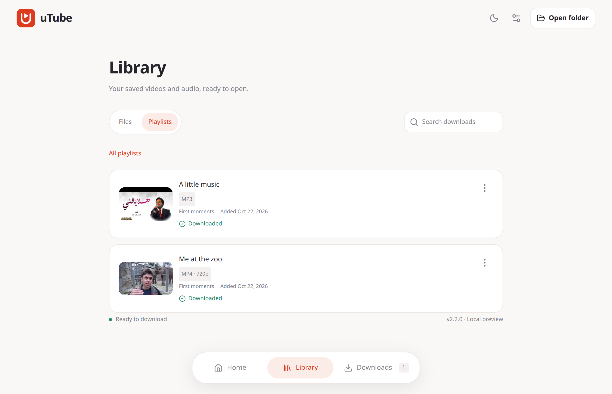

<div align="center">


# uTube

### Your YouTube library, offline. In one command or one click.

Download videos and whole playlists as **MP4** or **MP3** from a slick desktop app or a friendly terminal.

<br>

[](https://www.npmjs.com/package/utube-cli)
[](#-desktop-app)
[](LICENSE)

[🌐 Website](https://omer73364.github.io/uTube/) · [⚡ Quick start](#-quick-start) · [💻 CLI](#-cli) · [🖥️ Desktop](#-desktop-app) · [🛟 Help](#-troubleshooting)

<br>



</div>

<br>

## ✨ Why uTube?

| 🎞️ **Video or audio**                                            | 📚 **Whole playlists**                                           | 🧠 **Smart quality**                                              |
| :--------------------------------------------------------------- | :--------------------------------------------------------------- | :---------------------------------------------------------------- |
| MP4 in your chosen quality, or 192 kbps MP3 with title metadata. | Grab everything or hand-pick. Each playlist gets its own folder. | Can't get 1080p? uTube quietly steps down to the best that works. |

| 🔁 **Never lose progress**                                         | 🌙 **Looks great**            | 🌍 **English & العربية**              |
| :----------------------------------------------------------------- | :---------------------------- | :------------------------------------ |
| Desktop remembers your downloads, with search and one-click retry. | Light, dark, or system theme. | Full right-to-left layout for Arabic. |

<br>

## ⚡ Quick start

You need [Node.js](https://nodejs.org/) **20+** and [FFmpeg](https://ffmpeg.org/download.html) on your `PATH` (for MP3 conversion and merging HD video with audio).

```bash
npm install -g utube-cli@latest
utube
```

That's it. Paste a link and follow the prompts. ✅

> [!TIP]
> Prefer clicking over typing? Jump to the [desktop app](#-desktop-app).

<br>

## 💻 CLI

Run `utube` for the guided menu:

```
◆ What would you like to do?
❯ ↓  Download a video or playlist
  ♫  Download audio (MP3)
  ▣  Change download folder
  ↗  Exit
```

Use `↑` `↓` to move, `Enter` to confirm, and `Space` to select playlist items. A summary at the end shows what was saved, skipped, or failed. One bad item never stops the rest. 💪

### 🚀 Or go direct

```bash
# 🎥 Video: pick the quality interactively
utube -u "https://youtu.be/jNQXAC9IVRw"

# 🎯 Video: exact resolution, no prompts
utube -u "https://youtu.be/jNQXAC9IVRw" -q 720p

# 🎵 Audio: save as MP3
utube --audio -u "https://youtu.be/jNQXAC9IVRw"

# 📚 Playlist: choose all or specific items
utube -u "https://www.youtube.com/playlist?list=YOUR_PLAYLIST_ID"

# 📁 Set a default download folder
utube --set-download-folder "~/Downloads"
```

<details>
<summary><b>🔧 All options & notes</b></summary>

<br>

| Option                         | What it does                              |
| :----------------------------- | :---------------------------------------- |
| `-u <url>`                     | Video or playlist URL                     |
| `-q <quality>`                 | Resolution, e.g. `480p`, `720p`, `1080p`  |
| `-a`, `--audio`                | Download as MP3 (don't combine with `-q`) |
| `--set-download-folder <path>` | Save a default destination                |
| `--get-download-folder`        | Print the current destination             |
| `-v`, `--version`              | Show the installed version                |
| `-h`, `--help`                 | Show help                                 |

- 🤖 **Scripting:** video needs `-u` + `-q`; audio needs `--audio -u` only.
- 📚 **Playlists** need an interactive terminal (no piping).
- 📂 No saved folder? Files go to the current directory. Quote paths with spaces.
- ⚙️ Settings: `$XDG_CONFIG_HOME/utube-cli/settings.json` (or `~/.config/utube-cli/settings.json`).
- 🎨 `NO_COLOR` turns off colors; piped output uses plain status lines.
- ✈️ Help, version, and folder settings work offline.
- 🔄 Update with `npm install -g utube-cli@latest`, then check `utube --version`.

</details>

<br>

## 🖥️ Desktop app

A compact download form, a queue you can come back to, and instant access to your files.

> [!NOTE]
> **v2.2.0 is the first public preview.** Installers are unsigned and macOS builds aren't notarized.

### 📦 Download

Grab your installer from **[GitHub Releases](https://github.com/omer73364/uTube/releases/tag/v2.2.0)**:

|     | Platform                      | Formats                       |
| :-: | :---------------------------- | :---------------------------- |
| 🐧  | Linux (x64)                   | `.deb` · `.AppImage` · `.zip` |
| 🪟  | Windows (x64)                 | `Setup.exe` · portable `.zip` |
| 🍎  | macOS (Apple Silicon & Intel) | `.dmg` · `.zip`               |

No Node.js needed. The `.deb` installs FFmpeg for you; with other formats, install [FFmpeg](https://ffmpeg.org/download.html) yourself. Commands and checksums are in the [installation guide](docs/distribution.md).

### 🪄 How it works

1. 🔗 Paste a video or playlist link and hit **Find**
2. 🎚️ Choose video or audio, a resolution, and playlist items
3. 📁 Confirm the destination and start
4. 📋 Open **Queue** to search, filter, cancel, retry, or open finished files

### 💎 Nice touches

- 🧳 **History that sticks.** Titles, playlists, dates, quality, and file locations survive restarts.
- 🔍 **Find anything.** Search by name, filter by status, then open the file or its folder.
- 🎨 **Remembers you.** Folder, language, and theme are saved.
- ⌨️ **`Ctrl+L` / `⌘+L`** jumps to the link box, even on an Arabic keyboard.

<details>
<summary><b>🌙 See it in Arabic · dark mode</b></summary>

<br>


</details>

<details>
<summary><b>💤 What happens when I close it?</b></summary>

<br>

Your queue is saved locally in `downloads.json` in the app's user-data directory, and closing waits until the latest history is written. Unfinished downloads come back as **Interrupted**. Press **Retry** to restart them from the beginning. Nothing starts on its own. The queue holds up to 500 unfinished downloads; completed history is kept separately.

More in the [desktop guide](apps/desktop/README.md).

</details>

<details>
<summary><b>🛠️ Run the desktop app from source</b></summary>

<br>

Requires Node.js **22.13+**, npm **10.9+**, and FFmpeg.

```bash
git clone https://github.com/omer73364/uTube.git
cd uTube
npm ci
npm run desktop
```

</details>

<br>

## 📱 Android prototype

The [Android app](apps/mobile/README.md) now includes HD MP4 downloads, MP3
conversion, playlist selection, and a persistent background queue. Open or share
saved files, retry interrupted work, and choose Arabic or English with light/dark
appearance. It remains a local prototype; public mobile builds are not published.

## 🧪 How downloads work

**🎯 Quality first.** uTube tries your resolution first, including alternate encodings and clients (a `720p` request can use a `720p60` stream). If that fails, it falls back from the highest lower resolution down, and tells you what it saved. Retries are quiet and the progress bar never jumps back to zero.

**🔊 Sound included.** Separate video and audio streams are merged into MP4 with FFmpeg.

> [!NOTE]
> uTube can't create a resolution YouTube doesn't offer.

### 🗂️ Where files go

The desktop app defaults to your Downloads folder, the CLI to the current directory, and each remembers its own setting.

```
Downloads/
├── Video title [VIDEO_ID].mp4
├── Video title [VIDEO_ID].mp3
└── Playlist title/
    ├── #1_First video [VIDEO_ID].mp4
    └── #2_Second video [VIDEO_ID].mp4
```

Names are cleaned up and include the video ID, so same-titled videos never collide. Existing files are **skipped, never overwritten**. To re-download at a new quality, move or rename the old file first.

<br>

## 🛟 Troubleshooting

| 😕 Problem                | 💡 Try this                                                                   |
| :------------------------ | :---------------------------------------------------------------------------- |
| `utube` not found         | Reopen your terminal and make sure npm's global bin folder is on your `PATH`. |
| MP3 / HD merging fails    | Run `ffmpeg -version`. Install FFmpeg if needed and restart the desktop app.  |
| Got a lower resolution    | The requested one wasn't available, so the best working quality was used.     |
| File was skipped          | A file with that name exists. Move or rename it and retry.                    |
| Playlist needs a terminal | CLI playlists are interactive. Don't pipe it, or use the desktop app.         |
| Shows **Interrupted**     | Hit **Retry**. It restarts from the beginning.                                |
| YouTube rejects it        | Retry later, try another quality, and check the video is public.              |
| File won't open           | Make sure it still exists and your OS has a default app for MP4/MP3.          |

🐛 **Found a bug?** YouTube changes can break things. [Open an issue](https://github.com/omer73364/uTube/issues) with your OS, CLI or desktop, uTube and Node.js versions, the exact error, and a public example URL.

> [!WARNING]
> **Current limits:** Linux is the best-tested platform (Windows and macOS need more testing). No partial-download resume, authenticated downloads, or auto-update. Live-stream recording is unverified.

<br>

## 🧑‍💻 Development

```
apps/cli/       🖥️  Terminal interface and commands
apps/desktop/   🪟  Electron + React + TypeScript app
apps/mobile/    📱  React Native Android prototype
packages/core/  ⚙️  Shared YouTube & download engine
website/        🌐  Project site (GitHub Pages)
```

Requires Node.js **22.13+**, npm **10.9+**, and FFmpeg. (The published CLI still runs on Node.js 20+.)

```bash
npm ci
npm start                  # run the CLI
npm run desktop            # run the desktop app
npm start -- -u "https://youtu.be/jNQXAC9IVRw" -q 360p   # CLI with arguments

npm test                   # core, CLI, media, queue & history tests
npm run desktop:check      # type checking
npm run desktop:package    # package the desktop app
npm run desktop:test       # integration tests (needs a graphical session)
npm run desktop:make       # build local installers → apps/desktop/out/
npm run site:preview       # preview the website
npm run site:build         # build the website
```

<details>
<summary><b>📝 Testing & packaging notes</b></summary>

<br>

- Media tests use FFmpeg and FFprobe on real output, and are skipped if the tools are missing.
- Desktop integration tests need a graphical session and cover downloads, playlists, recovery, file actions, themes, Arabic/RTL, and history across restarts. Build the desktop first.
- Debian packaging needs `dpkg` and `fakeroot`. Packaging creates local files and never publishes anything.
- The website deploys to GitHub Pages automatically when changes reach `main`. See the [website guide](website/README.md).

</details>

<br>

## 🤝 Contributing

Bug reports, fixes, and translations are all welcome! 💙 For bigger changes, please open an issue first. Want to add a language? Follow the [desktop guide](apps/desktop/README.md#adding-a-language). See the [changelog](CHANGELOG.md) for release history.

## ⚖️ Disclaimer

uTube is meant for content you have the right to download. Downloading may violate YouTube's Terms of Service or copyright law where you live, and you're responsible for how you use it.

## 📄 License

[MIT](LICENSE) © Omer Anwar

<div align="center">

<br>

**If uTube saved you time, drop it a ⭐. It really helps!**

</div>
